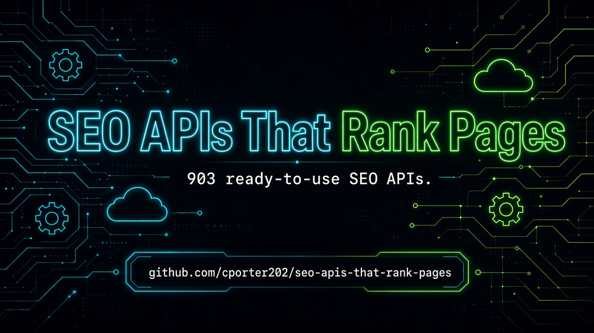

 
 

  <a href="#at-a-glance"><strong>At A Glance</strong></a>
  |
  <a href="#start-here"><strong>Start Here</strong></a>
  |
  <a href="#explore-the-stack"><strong>Explore The Stack</strong></a>
  |
  <a href="#why-this-repo-wins"><strong>Why This Repo Wins</strong></a>
  |
  <a href="#star-history"><strong>Star History</strong></a>

### 🚀 Join My Skool Community

**Want to learn how to vibe code like the pros? Join my Skool community! 🎯**

*I'll show you how to set up applications to use these APIs and start making money! I have the best tech stack when it comes to vibe coding that virtually costs nothing. Forget tools like Loveable, Replit, Manus, Base44, etc.*

 

  <a href="https://www.skool.com/vibe-coding-with-chris-7196" target="_blank" style="display: inline-block; background: #667eea; background-image: linear-gradient(135deg, #667eea 0%, #764ba2 100%); color: #ffffff !important; text-decoration: none !important; padding: 18px 45px; font-size: 18px; font-weight: bold; border-radius: 35px; box-shadow: 0 8px 25px rgba(102, 126, 234, 0.5); letter-spacing: 1px; text-transform: uppercase; border: 2px solid rgba(255, 255, 255, 0.3); cursor: pointer; font-family: -apple-system, BlinkMacSystemFont, 'Segoe UI', Helvetica, Arial, sans-serif;">
    🚀 Join Vibe Coding Community →
  </a>

<!-- APIMESA-FEATURED-START -->
## ⭐ Featured: APIMesa

  

**[APIMesa](https://apimesa.com)** is a pay-per-call API marketplace with 150+ live APIs for AI, scraping, data, SEO, lead generation, media, and developer utilities — one API key, clear per-call credit pricing, and a live playground for every API.

<!-- APIMESA-FEATURED-END -->

## At A Glance

> The ultimate collection of SEO APIs — keyword research, technical audits, backlinks, and content optimization you can start using immediately. **903 production-ready APIs** across **5 navigable sections**.

This repository is designed to feel like a launchpad, not a junk drawer. Pick a section folder, scan the API table, and click through to the provider — no endless flat scrolling.

| Metric | Count |
|--------|-------|
| Total APIs | 903 |
| Categories | 5 |
| Last Updated | 2026-09-16 |
| Focus | SEO Rankings |

<table>
  <tr>
    <td width="33%" valign="top">
      <h3>Keyword Research</h3>
      
<strong>287 APIs</strong>

      
Keyword discovery, SERP intel, search volume, and autocomplete tools.

      
<a href="./keyword-research/"><strong>Open Keyword Research Directory</strong></a>

    </td>
    <td width="33%" valign="top">
      <h3>Technical Audits</h3>
      
<strong>161 APIs</strong>

      
Lighthouse, Core Web Vitals, sitemaps, DNS/WHOIS, crawlability, and site health.

      
<a href="./technical-audits/"><strong>Open Technical Audits Directory</strong></a>

    </td>
    <td width="33%" valign="top">
      <h3>Backlinks & Authority</h3>
      
<strong>23 APIs</strong>

      
Backlink checkers, domain rating, referring domains, and authority metrics.

      
<a href="./backlinks-authority/"><strong>Open Backlinks & Authority Directory</strong></a>

    </td>
  </tr>
  <tr>
    <td width="50%" valign="top">
      <h3>Content Optimization</h3>
      
<strong>28 APIs</strong>

      
On-page SEO, content scoring, copy tips, and SEO content analysis.

      
<a href="./content-optimization/"><strong>Open Content Optimization Directory</strong></a>

    </td>
    <td width="50%" valign="top">
      <h3>Other SEO Tools</h3>
      
<strong>404 APIs</strong>

      
Everything else SEO-adjacent — niche scrapers, directories, and misc ranking helpers.

      
<a href="./other-seo-tools/"><strong>Open Other SEO Tools Directory</strong></a>

    </td>
    <td width="50%"></td>
  </tr>
</table>

## Start Here

1. Pick the section you need first from the cards above.
2. Open that folder's README and scan the API names and descriptions.
3. Click through to the provider page for implementation details, pricing, and docs.
4. Build your shortlist fast instead of wasting hours digging through a flat list.

## Explore The Stack

<strong>Keyword Research</strong> (287)

Keyword discovery, SERP intel, search volume, and autocomplete tools.

- keyword discovery / autocomplete
- SERP & rank tracking
- search volume & intent
- long-tail opportunities

[Browse Keyword Research APIs](./keyword-research/)

<strong>Technical Audits</strong> (161)

Lighthouse, Core Web Vitals, sitemaps, DNS/WHOIS, crawlability, and site health.

- Lighthouse / Core Web Vitals
- sitemap & crawl audits
- DNS / WHOIS / SSL
- tech stack & indexability

[Browse Technical Audits APIs](./technical-audits/)

<strong>Backlinks & Authority</strong> (23)

Backlink checkers, domain rating, referring domains, and authority metrics.

- backlink profiles
- domain / URL rating
- referring domains
- authority & link intel

[Browse Backlinks & Authority APIs](./backlinks-authority/)

<strong>Content Optimization</strong> (28)

On-page SEO, content scoring, copy tips, and SEO content analysis.

- on-page SEO scoring
- content optimization
- copy / meta tips
- SEO content analysis

[Browse Content Optimization APIs](./content-optimization/)

<strong>Other SEO Tools</strong> (404)

Everything else SEO-adjacent — niche scrapers, directories, and misc ranking helpers.

- niche SEO scrapers
- directory / listing tools
- competitive research
- misc ranking helpers

[Browse Other SEO Tools APIs](./other-seo-tools/)

## Built For

<table>
  <tr>
    <td width="25%" align="center"><strong>SEO Agencies</strong></td>
    <td width="25%" align="center"><strong>In-House SEO</strong></td>
    <td width="25%" align="center"><strong>Content Marketers</strong></td>
    <td width="25%" align="center"><strong>Growth Teams</strong></td>
  </tr>
  <tr>
    <td width="25%" align="center"><strong>Affiliate Marketers</strong></td>
    <td width="25%" align="center"><strong>SaaS Founders</strong></td>
    <td width="25%" align="center"><strong>Technical SEOs</strong></td>
    <td width="25%" align="center"><strong>GEO / AEO Builders</strong></td>
  </tr>
</table>

## Why This Repo Wins

- It is opinionated. Sections map to how builders actually search for APIs.
- It is navigable. Top-level folders beat one giant markdown table every time.
- It is faster to use. Jump straight to the category that matches your use case.
- It keeps affiliate tracking intact (`?fpr=p2hrc6`) on every link.
- Custom PNG hero banner — crisp and launch-ready.

## Scope Guarantee

This repository intentionally organizes APIs into:

**Keyword Research**, **Technical Audits**, **Backlinks & Authority**, **Content Optimization**, **Other SEO Tools**

Unmatched rows land in the `other-*` catch-all so **zero APIs are dropped**.

## Follow the Creator

See [FOLLOW_CREATOR.md](./FOLLOW_CREATOR.md) — follow Chris Porter on Facebook for more valuable repos and updates.

## Star History

## Maintenance Notes

- Section classification is keyword-based on API name + description.
- Every original table row is preserved exactly, including affiliate params.
- Visual launchpad layout matches the style of [marketing-apis-that-drive-roi](https://github.com/cporter202/marketing-apis-that-drive-roi).

<!-- AIWITHCHRIS-BANNER-START -->

  

  <a href="https://aiwithchris.com"><strong>🚀 Join my AI Playbook — aiwithchris.com</strong></a> 
  $10/month · 3,600+ prompts · agent workflows · repo breakdowns · money ideas

<!-- AIWITHCHRIS-BANNER-END -->

